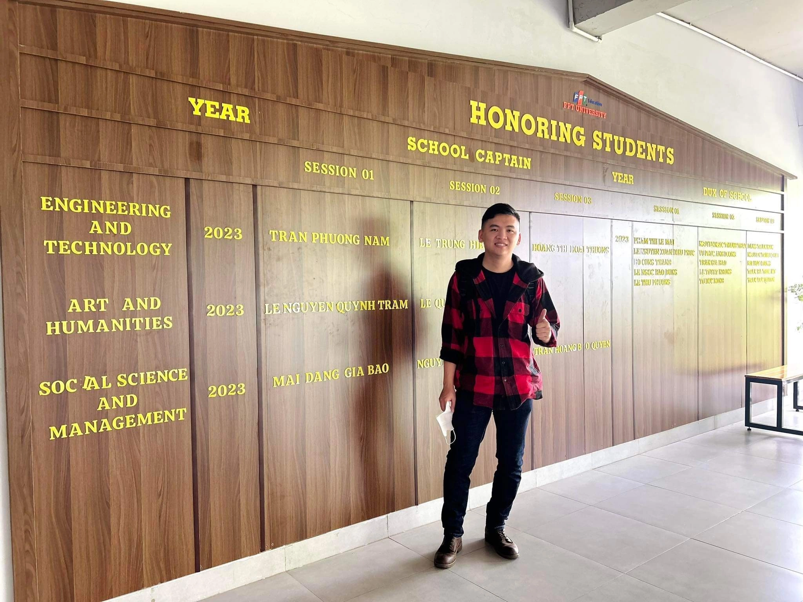
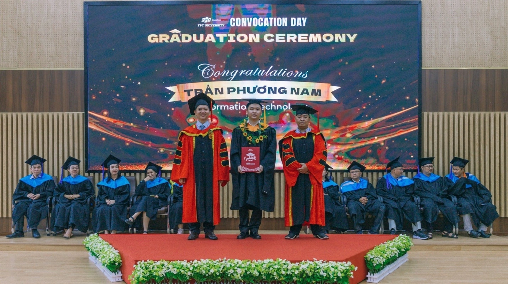
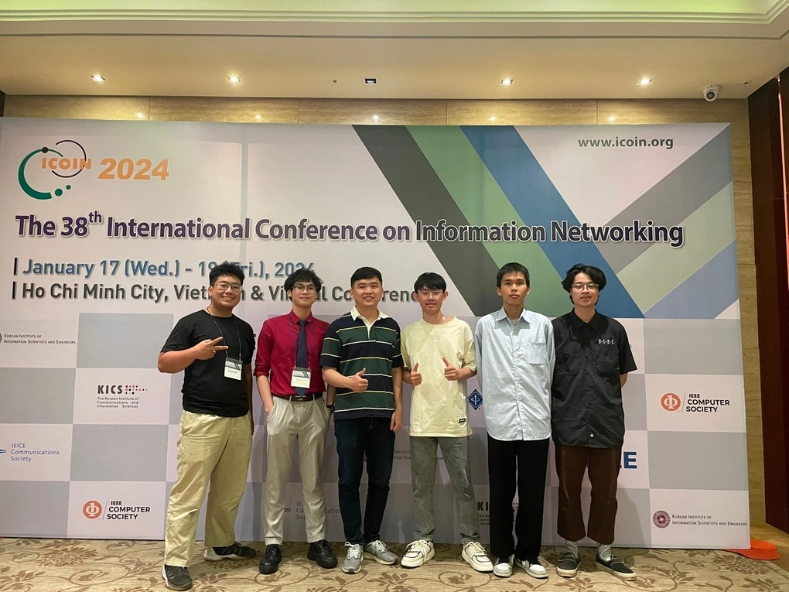

  <button type="button" class="btn btn--primary" data-lang="en">English</button>
  <button type="button" class="btn btn--inverse" data-lang="vi">Tiếng Việt</button>

**Original article (VnExpress, in Vietnamese):** [Thủ khoa đầu ra ĐH FPT nhận học bổng 100% từ Hàn Quốc](https://vnexpress.net/thu-khoa-dau-ra-dh-fpt-nhan-hoc-bong-100-tu-han-quoc-4773178.html)
{: .notice--info}

On July 23, 2024, VnExpress published a story about my path from a stable job in Lâm Đồng back to university, and on to a fully funded PhD in South Korea.

## Starting over

I was born in 1996. A few years into a steady job in Lâm Đồng, I left it to go back to school and study Information Technology at FPT University, Ho Chi Minh City campus. It was a risky move, but I wanted to work in computing and research.

<figure>
  
  <figcaption>Phương Nam earned many outstanding academic results at FPT University, Ho Chi Minh City campus. Photo: FPT University</figcaption>
</figure>

## Top graduate in Information Technology

In 2023 I graduated as the **valedictorian of the Information Technology program** at FPT University, Ho Chi Minh City campus.

<figure>
  
  <figcaption>Phương Nam, top graduate of the Information Technology program in 2023, FPT University, Ho Chi Minh City campus. Photo: FPT University</figcaption>
</figure>

## Research during my undergraduate studies

During my studies I got into research early:

- I was **first author of two research papers**, published by **Springer** and **IEEE**.
- One of them won a **Best Paper Award at ICTC**.
- I was also a co-author on papers submitted to **ICIIT** and **ICOIN**. In 2024 I presented work at the ICOIN conference.

<figure>
  
  <figcaption>Phương Nam (third from left) presenting research at ICOIN 2024. Photo: provided by Phương Nam</figcaption>
</figure>

## A 100% PhD scholarship at Kyung Hee University

These results helped me win a **100% scholarship for a PhD in Computer Science at Kyung Hee University**, South Korea.

## Looking ahead

My PhD focus is **Artificial Intelligence**. After graduating, I want to keep doing research or become a university lecturer. I also want to build long-term skills in teaching and management.

Thanks to FPT University, my mentors, and everyone who supported me along the way.

**Bài báo gốc (VnExpress):** [Thủ khoa đầu ra ĐH FPT nhận học bổng 100% từ Hàn Quốc](https://vnexpress.net/thu-khoa-dau-ra-dh-fpt-nhan-hoc-bong-100-tu-han-quoc-4773178.html)
{: .notice--info}

Ngày 23/7/2024, VnExpress đăng bài viết về hành trình của tôi: từ một công việc ổn định ở Lâm Đồng quay lại giảng đường, rồi giành học bổng toàn phần nghiên cứu sinh tiến sĩ tại Hàn Quốc.

## Bắt đầu lại

Tôi sinh năm 1996. Sau vài năm làm một công việc ổn định ở Lâm Đồng, tôi quyết định nghỉ việc để đi học lại ngành Công nghệ thông tin tại Trường Đại học FPT, phân hiệu TP HCM. Đó là một quyết định mạo hiểm, nhưng tôi muốn theo đuổi lĩnh vực máy tính và nghiên cứu.

<figure>
  
  <figcaption>Phương Nam đạt nhiều thành tích học tập xuất sắc tại Trường Đại học FPT phân hiệu TP HCM. Ảnh: Trường Đại học FPT</figcaption>
</figure>

## Thủ khoa ngành Công nghệ thông tin

Năm 2023, tôi tốt nghiệp với danh hiệu **thủ khoa đầu ra khối ngành Công nghệ thông tin** của Trường Đại học FPT, phân hiệu TP HCM.

<figure>
  
  <figcaption>Phương Nam là thủ khoa đầu ra khối ngành Công nghệ thông tin năm 2023, Trường Đại học FPT phân hiệu TP HCM. Ảnh: Trường Đại học FPT</figcaption>
</figure>

## Nghiên cứu khoa học từ thời sinh viên

Ngay từ khi còn là sinh viên, tôi đã tham gia nghiên cứu khoa học:

- Tôi là **tác giả chính của hai bài báo khoa học**, được xuất bản bởi **Springer** và **IEEE**.
- Một trong hai bài đạt **giải Bài báo xuất sắc nhất (Best Paper Award) tại hội nghị ICTC**.
- Tôi cũng là đồng tác giả của các bài báo gửi tới hội nghị **ICIIT** và **ICOIN**. Năm 2024, tôi tham gia báo cáo khoa học tại hội nghị ICOIN.

<figure>
  
  <figcaption>Phương Nam (thứ 3 từ trái sang) tham gia báo cáo khoa học tại hội nghị ICOIN 2024. Ảnh: Nhân vật cung cấp</figcaption>
</figure>

## Học bổng 100% nghiên cứu sinh tại Đại học Kyung Hee

Những kết quả này giúp tôi nhận được **học bổng 100% chương trình tiến sĩ ngành Khoa học máy tính tại Đại học Kyung Hee**, Hàn Quốc.

## Định hướng tương lai

Trong chương trình tiến sĩ, tôi tập trung nghiên cứu về **Trí tuệ nhân tạo**. Sau khi tốt nghiệp, tôi muốn tiếp tục làm nghiên cứu hoặc trở thành giảng viên đại học, đồng thời rèn luyện lâu dài các kỹ năng giảng dạy và quản lý.

Cảm ơn Trường Đại học FPT, các thầy cô hướng dẫn và tất cả những người đã đồng hành cùng tôi.

