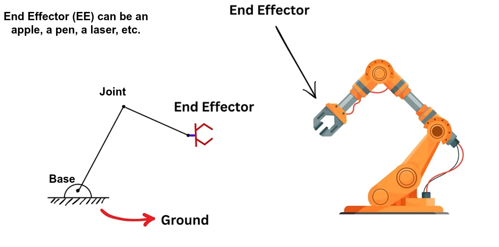
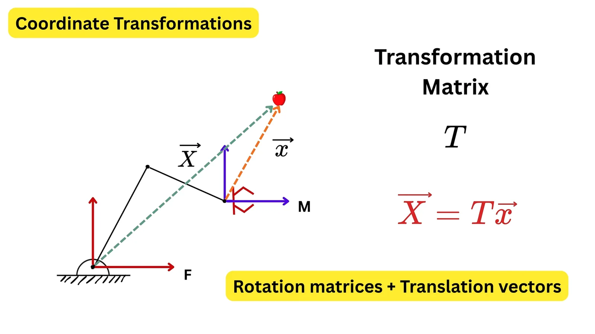
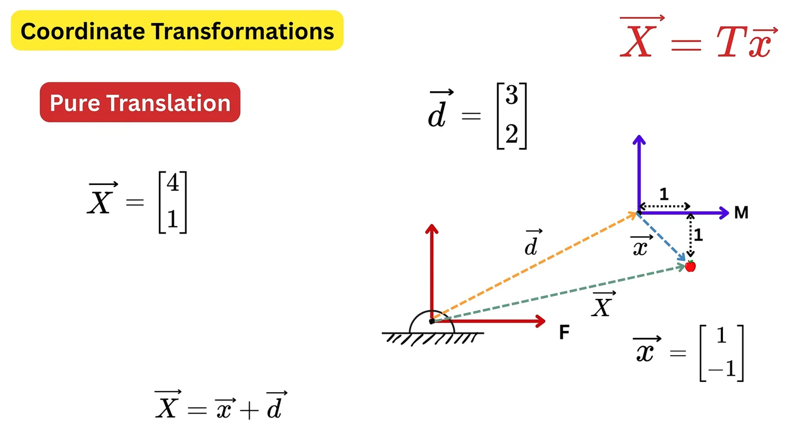
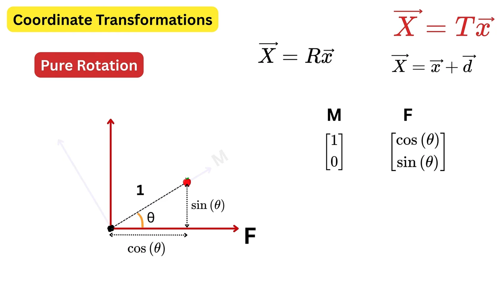
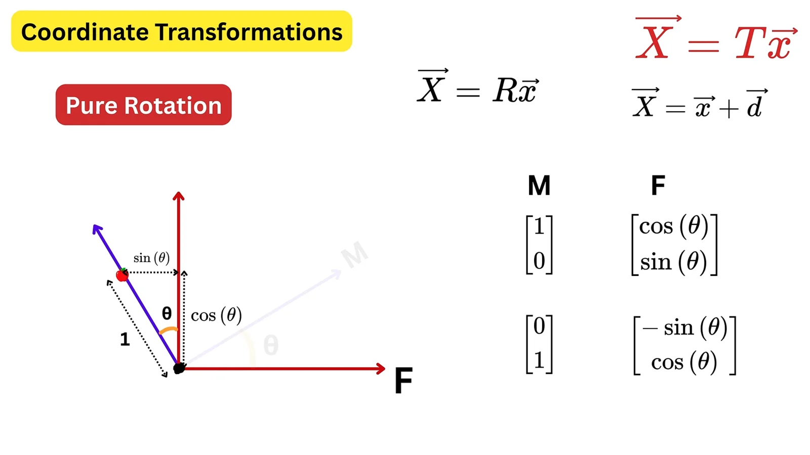
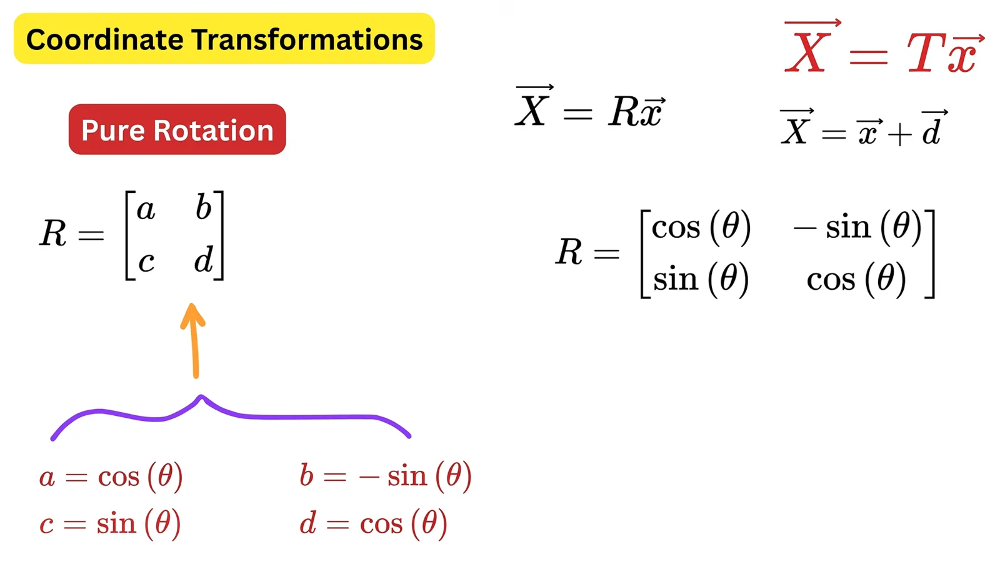
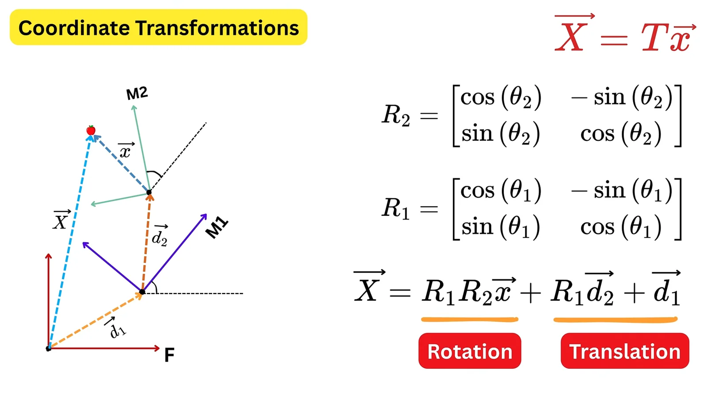
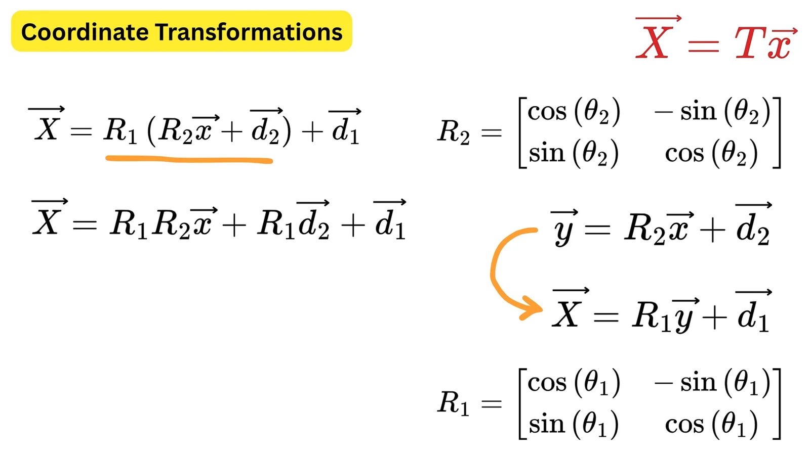
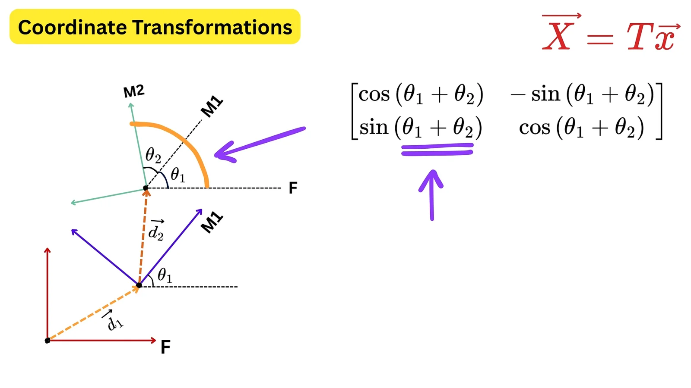
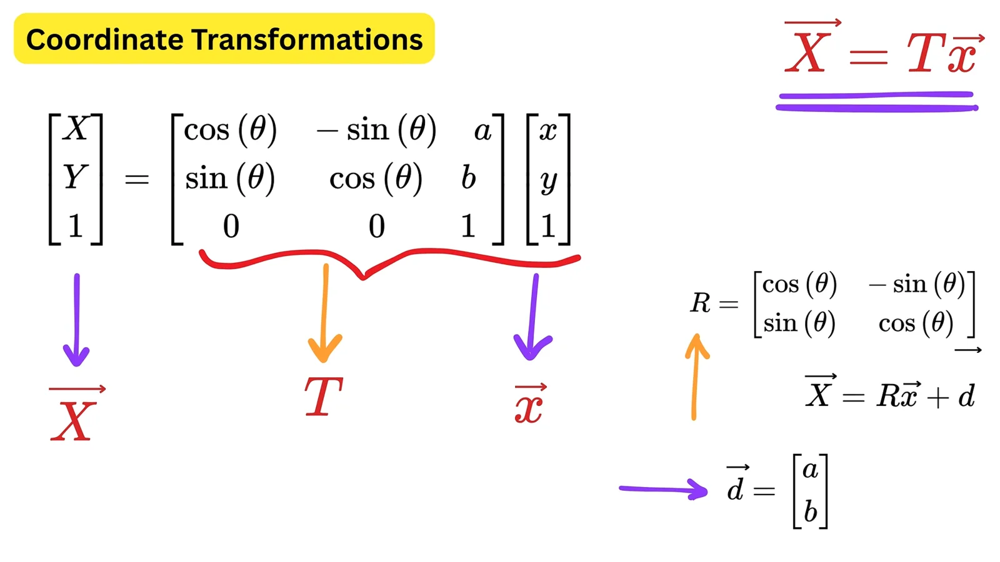

  <button type="button" class="btn btn--primary" data-lang="en">English</button>
  <button type="button" class="btn btn--inverse" data-lang="vi">Tiếng Việt</button>

**Learning from:** [It is Easier Than Solving Quadratic Equation](https://www.youtube.com/watch?v=FvgGSgvB2I0) (YouTube)
{: .notice--info}

These are my notes on the video above, written the way I understand it. If you find a mistake, please email or message me.

## 1. Parts of a robot arm

<figure>
  
  <figcaption>Fig 1. Base, joint and end effector.</figcaption>
</figure>

A robot arm has three main parts:

- **Base**: fixed to the ground.
- **Joints**: the parts that rotate. Rigid links connect them. For example, the Franka arm has 7 joints and the Piper arm has 6.
- **End effector (EE)**: the tool at the tip of the arm. It can be a gripper, a pen, a laser, or anything else the task needs.

The end effector is not a joint. It is mounted after the last joint, and the arm moves it by moving its joints.

## 2. The question: where is the apple?

<figure>
  
  <figcaption>Fig 2. Fixed frame F and moving frame M.</figcaption>
</figure>

We use two coordinate frames:

- **F (fixed frame)**: attached to the base. It never moves.
- **M (moving frame)**: attached to the end effector. It moves and rotates with the EE.

Suppose we know where the apple is as seen from M: the vector $$\vec{x}$$. To control the robot we need the apple's position as seen from F: the vector $$\vec{X}$$. We want a **transformation matrix** $$T$$ such that

$$\vec{X} = T\vec{x}$$
where $$T$$ is made of two parts: a **translation** (shift) and a **rotation**.

## 3. Pure translation

<figure>
  
  <figcaption>Fig 3. Pure translation.</figcaption>
</figure>

Suppose M is only shifted from F by a vector $$\vec{d}$$, and its axes are still parallel to F's axes. Then we just add the two vectors:

$$\vec{X} = \vec{x} + \vec{d}$$

Example: $$\vec{d} = (3, 2)$$ and $$\vec{x} = (1, -1)$$, so $$\vec{X} = (4, 1)$$.

On a robot, $$\vec{d}$$ is the link that goes from the origin of F to the origin of M.

## 4. Pure rotation

Now put M at the same origin as F, but rotate it by an angle $$\theta$$ (counter-clockwise is positive). Where do M's axes point when we look from F?

<figure>
  
  <figcaption>Fig 4. M's x-axis seen from F.</figcaption>
</figure>

**M's x-axis.** The unit vector $$(1, 0)$$ in M has length 1 and makes angle $$\theta$$ with F's x-axis. Right-triangle trigonometry gives $$(\cos\theta, \sin\theta)$$ in F. For example, with $$\theta = 90^\circ$$ it becomes $$(0, 1)$$, pointing along F's y-axis.

<figure>
  
  <figcaption>Fig 5. M's y-axis seen from F.</figcaption>
</figure>

**M's y-axis.** The unit vector $$(0, 1)$$ in M also turns by $$\theta$$, so it leans to the **left** of F's y-axis, toward negative x. It becomes $$(-\sin\theta, \cos\theta)$$. That is where the minus sign comes from.

<figure>
  
  <figcaption>Fig 6. The rotation matrix R.</figcaption>
</figure>

Put these two results side by side as columns and we get the **rotation matrix**:

$$R = \begin{bmatrix}\cos\theta & -\sin\theta \\ \sin\theta & \cos\theta\end{bmatrix}, \qquad \vec{X} = R\vec{x}$$

Each column of $$R$$ is one axis of M written in F's coordinates. For a clockwise rotation, use $$-\theta$$: the minus sign then moves to the bottom-left entry.

## 5. Chaining two joints

<figure>
  
  <figcaption>Fig 7. Two joints, two moving frames.</figcaption>
</figure>

A real arm has several joints, and each joint has its own frame. With two joints:

- M1 is rotated by $$\theta_1$$ and shifted by $$\vec{d}_1$$ from F.
- M2 is rotated by $$\theta_2$$ and shifted by $$\vec{d}_2$$ from M1 (both measured in M1).
- And $$\vec{x}$$ is the apple seen from M2.

We work from the tip back to the base, one frame at a time:

1. Apple seen from M1: $$\vec{y} = R_2\vec{x} + \vec{d}_2$$
2. Apple seen from F: $$\vec{X} = R_1\vec{y} + \vec{d}_1$$

<figure>
  
  <figcaption>Fig 8. Substituting one step into the next.</figcaption>
</figure>

Substituting the first into the second:

$$\vec{X} = \underbrace{R_1R_2\vec{x}}_{\text{rotation}} + \underbrace{R_1\vec{d}_2 + \vec{d}_1}_{\text{translation}}$$

<figure>
  
  <figcaption>Fig 9. In 2D, the angles add up.</figcaption>
</figure>

**Rotation.** Let's multiply $$R_1R_2$$ out and see what we get.

First, a quick recall of the angle-sum and angle-difference formulas:

$$\begin{aligned}
\cos(a + b) &= \cos a\cos b - \sin a\sin b \\
\cos(a - b) &= \cos a\cos b + \sin a\sin b \\
\sin(a + b) &= \sin a\cos b + \cos a\sin b \\
\sin(a - b) &= \sin a\cos b - \cos a\sin b
\end{aligned}$$

Now multiply the two rotation matrices (row × column):

$$R_1R_2 = \begin{bmatrix}\cos\theta_1 & -\sin\theta_1 \\ \sin\theta_1 & \cos\theta_1\end{bmatrix}\begin{bmatrix}\cos\theta_2 & -\sin\theta_2 \\ \sin\theta_2 & \cos\theta_2\end{bmatrix}$$

$$= \begin{bmatrix}\cos\theta_1\cos\theta_2 - \sin\theta_1\sin\theta_2 & -(\sin\theta_1\cos\theta_2 + \cos\theta_1\sin\theta_2) \\ \sin\theta_1\cos\theta_2 + \cos\theta_1\sin\theta_2 & \cos\theta_1\cos\theta_2 - \sin\theta_1\sin\theta_2\end{bmatrix}$$

Each entry matches one of the formulas above:

- $$\cos\theta_1\cos\theta_2 - \sin\theta_1\sin\theta_2 = \cos(\theta_1 + \theta_2)$$
- $$\sin\theta_1\cos\theta_2 + \cos\theta_1\sin\theta_2 = \sin(\theta_1 + \theta_2)$$

So:

$$R_1R_2 = \begin{bmatrix}\cos(\theta_1 + \theta_2) & -\sin(\theta_1 + \theta_2) \\ \sin(\theta_1 + \theta_2) & \cos(\theta_1 + \theta_2)\end{bmatrix} = R(\theta_1 + \theta_2)$$

This is just the rotation matrix for the angle $$\theta_1 + \theta_2$$. So in 2D, the total rotation is the sum of the joint angles. (If a joint turns clockwise, its angle is negative, and the $$a - b$$ formulas give the same result with $$\theta_1 - \theta_2$$.)

**Translation.** The total shift is **not** simply $$\vec{d}_1 + \vec{d}_2$$. Because $$\vec{d}_2$$ is measured in M1, which is already rotated, we must rotate it first:

$$\vec{d} = \vec{d}_1 + R_1\vec{d}_2$$

## 6. One matrix for both: homogeneous coordinates

<figure>
  
  <figcaption>Fig 10. Rotation and translation in one matrix.</figcaption>
</figure>

Rotation is a multiplication, but translation is an addition. To do both with a single matrix multiplication, add an extra **1** at the end of each vector and make the matrix 3×3:

$$\begin{bmatrix}X\\Y\\1\end{bmatrix} = \begin{bmatrix}\cos\theta & -\sin\theta & a\\ \sin\theta & \cos\theta & b\\ 0 & 0 & 1\end{bmatrix}\begin{bmatrix}x\\y\\1\end{bmatrix}$$

Multiply it out to check:

$$\begin{aligned} X &= x\cos\theta - y\sin\theta + a \\ Y &= x\sin\theta + y\cos\theta + b \\ 1 &= 1 \end{aligned}$$

This is exactly $$\vec{X} = R\vec{x} + \vec{d}$$ with $$\vec{d} = (a, b)$$. The extra 1 is not a real z-coordinate. It is a trick that lets us write a translation as a multiplication.

The payoff: a whole arm becomes a chain of matrix products, one matrix per joint:

$$\vec{X} = T_1 T_2 \cdots T_n \, \vec{x}$$

## Summary

- A robot arm = base + joints (connected by links) + end effector.
- **Translation**: add $$\vec{d}$$. **Rotation**: multiply by $$R$$; the columns of $$R$$ are M's axes seen from F.
- Chain frames from the tip back to the base: $$\vec{X} = R_1R_2\vec{x} + R_1\vec{d}_2 + \vec{d}_1$$.
- Homogeneous coordinates pack rotation and translation into one matrix (3×3 in 2D, 4×4 in 3D), so chaining joints is just multiplying matrices.
- Adding angles only works in 2D. In 3D you must multiply the rotation matrices, and the order matters.

**Học từ:** [It is Easier Than Solving Quadratic Equation](https://www.youtube.com/watch?v=FvgGSgvB2I0) (YouTube)
{: .notice--info}

Đây là ghi chú của mình khi học video trên, viết theo cách mình hiểu. Nếu mình hiểu sai chỗ nào, hãy giúp mình chỉ ra bằng email hoặc nhắn tin cho mình nhé.

## 1. Các thành phần của cánh tay robot

<figure>
  
  <figcaption>Hình 1. Base, joint và end effector.</figcaption>
</figure>

Cánh tay robot gồm ba phần chính:

- **Base (đế)**: gắn cố định xuống mặt đất.
- **Joints (khớp)**: các bộ phận xoay được, nối với nhau bằng các thanh cứng (link). Ví dụ: Franka có 7 khớp, Piper có 6 khớp.
- **End effector (EE)**: dụng cụ ở đầu cánh tay. Có thể là đầu gắp, cây bút, tia laser, hoặc bất cứ thứ gì phù hợp với mục đích.

End effector không phải là một khớp. Nó được gắn sau khớp cuối cùng, và robot di chuyển EE bằng cách xoay các khớp.

## 2. Bài toán: quả táo nằm ở đâu?

<figure>
  
  <figcaption>Hình 2. Hệ cố định F và hệ di chuyển M.</figcaption>
</figure>

Ta dùng hai hệ tọa độ:

- **F (fixed frame, hệ cố định)**: gắn với base, không bao giờ di chuyển.
- **M (moving frame, hệ di chuyển)**: gắn với end effector, di chuyển và xoay cùng EE.

Giả sử ta biết vị trí quả táo khi nhìn từ M: vector $$\vec{x}$$. Để điều khiển robot, ta cần biết vị trí quả táo khi nhìn từ F: vector $$\vec{X}$$. Ta cần tìm **ma trận biến đổi** $$T$$ sao cho

$$\vec{X} = T\vec{x}$$
trong đó $$T$$ gồm hai phần: **phép dịch chuyển** (translation) và **phép xoay** (rotation).

## 3. Phép dịch chuyển

<figure>
  
  <figcaption>Hình 3. Phép dịch chuyển.</figcaption>
</figure>

Giả sử M chỉ bị dịch khỏi F một vector $$\vec{d}$$, các trục của M vẫn song song với các trục của F. Khi đó chỉ cần cộng hai vector:

$$\vec{X} = \vec{x} + \vec{d}$$

Ví dụ: $$\vec{d} = (3, 2)$$ và $$\vec{x} = (1, -1)$$, nên $$\vec{X} = (4, 1)$$.

Trên robot, $$\vec{d}$$ chính là thanh nối (link) đi từ gốc của F đến gốc của M.

## 4. Phép xoay

Bây giờ đặt M trùng gốc với F, nhưng xoay một góc $$\theta$$ (ngược chiều kim đồng hồ là chiều dương). Khi nhìn từ F, các trục của M chỉ về đâu?

<figure>
  
  <figcaption>Hình 4. Trục x của M nhìn từ F.</figcaption>
</figure>

**Trục x của M.** Vector đơn vị $$(1, 0)$$ trong M dài 1 và tạo góc $$\theta$$ với trục x của F. Dùng lượng giác trong tam giác vuông, ta được $$(\cos\theta, \sin\theta)$$ trong F. Ví dụ, khi $$\theta = 90^\circ$$ thì nó thành $$(0, 1)$$, nằm trên trục y của F.

<figure>
  
  <figcaption>Hình 5. Trục y của M nhìn từ F.</figcaption>
</figure>

**Trục y của M.** Vector đơn vị $$(0, 1)$$ trong M cũng xoay một góc $$\theta$$, nên nó nghiêng sang **bên trái** trục y của F, tức là về phía x âm. Nó trở thành $$(-\sin\theta, \cos\theta)$$. Dấu trừ xuất hiện là vì vậy.

<figure>
  
  <figcaption>Hình 6. Ma trận xoay R.</figcaption>
</figure>

Đặt hai kết quả trên thành hai cột, ta được **ma trận xoay**:

$$R = \begin{bmatrix}\cos\theta & -\sin\theta \\ \sin\theta & \cos\theta\end{bmatrix}, \qquad \vec{X} = R\vec{x}$$

Mỗi cột của $$R$$ là một trục của M được viết trong tọa độ của F. Nếu xoay cùng chiều kim đồng hồ thì dùng $$-\theta$$: khi đó dấu trừ chuyển xuống ô dưới bên trái.

## 5. Kết hợp hai khớp

<figure>
  
  <figcaption>Hình 7. Hai khớp, hai hệ di chuyển.</figcaption>
</figure>

Cánh tay thật có nhiều khớp, mỗi khớp có một hệ tọa độ riêng. Với hai khớp:

- M1 xoay $$\theta_1$$ và dịch $$\vec{d}_1$$ so với F.
- M2 xoay $$\theta_2$$ và dịch $$\vec{d}_2$$ so với M1 (cả hai đều đo trong M1).
- Và $$\vec{x}$$ là quả táo nhìn từ M2.

Ta đi từ đầu cánh tay về base, từng hệ một:

1. Quả táo nhìn từ M1: $$\vec{y} = R_2\vec{x} + \vec{d}_2$$
2. Quả táo nhìn từ F: $$\vec{X} = R_1\vec{y} + \vec{d}_1$$

<figure>
  
  <figcaption>Hình 8. Thay bước này vào bước kia.</figcaption>
</figure>

Thay (1) vào (2):

$$\vec{X} = \underbrace{R_1R_2\vec{x}}_{\text{xoay}} + \underbrace{R_1\vec{d}_2 + \vec{d}_1}_{\text{dịch chuyển}}$$

<figure>
  
  <figcaption>Hình 9. Trong 2D, các góc cộng lại với nhau.</figcaption>
</figure>

**Phép xoay.** Hãy nhân $$R_1R_2$$ ra xem được gì.

Trước tiên, nhắc lại công thức cộng và trừ góc lượng giác:

$$\begin{aligned}
\cos(a + b) &= \cos a\cos b - \sin a\sin b \\
\cos(a - b) &= \cos a\cos b + \sin a\sin b \\
\sin(a + b) &= \sin a\cos b + \cos a\sin b \\
\sin(a - b) &= \sin a\cos b - \cos a\sin b
\end{aligned}$$

Bây giờ nhân hai ma trận xoay (hàng × cột):

$$R_1R_2 = \begin{bmatrix}\cos\theta_1 & -\sin\theta_1 \\ \sin\theta_1 & \cos\theta_1\end{bmatrix}\begin{bmatrix}\cos\theta_2 & -\sin\theta_2 \\ \sin\theta_2 & \cos\theta_2\end{bmatrix}$$

$$= \begin{bmatrix}
\cos\theta_1\cos\theta_2 - \sin\theta_1\sin\theta_2 
& -(\sin\theta_1\cos\theta_2 + \cos\theta_1\sin\theta_2) 
\\ \sin\theta_1\cos\theta_2 + \cos\theta_1\sin\theta_2 
& \cos\theta_1\cos\theta_2 - \sin\theta_1\sin\theta_2\end{bmatrix}$$

Mỗi phần tử khớp với một công thức ở trên:

- $$\cos\theta_1\cos\theta_2 - \sin\theta_1\sin\theta_2 = \cos(\theta_1 + \theta_2)$$
- $$\sin\theta_1\cos\theta_2 + \cos\theta_1\sin\theta_2 = \sin(\theta_1 + \theta_2)$$

Vậy:

$$R_1R_2 = \begin{bmatrix}\cos(\theta_1 + \theta_2) & -\sin(\theta_1 + \theta_2) \\ \sin(\theta_1 + \theta_2) & \cos(\theta_1 + \theta_2)\end{bmatrix} = R(\theta_1 + \theta_2)$$

Đây chính là ma trận xoay của góc $$\theta_1 + \theta_2$$. Vậy trong 2D, góc xoay tổng là tổng các góc của các khớp. (Nếu một khớp xoay cùng chiều kim đồng hồ thì góc của nó mang dấu âm, và công thức $$a - b$$ cho kết quả tương tự với $$\theta_1 - \theta_2$$.)

**Phép dịch chuyển.** Vector dịch tổng **không** đơn giản là $$\vec{d}_1 + \vec{d}_2$$. Vì $$\vec{d}_2$$ được đo trong M1, mà M1 đã bị xoay, nên phải xoay $$\vec{d}_2$$ trước:

$$\vec{d} = \vec{d}_1 + R_1\vec{d}_2$$

## 6. Gộp cả hai vào một ma trận: tọa độ thuần nhất

<figure>
  
  <figcaption>Hình 10. Xoay và dịch chuyển trong cùng một ma trận.</figcaption>
</figure>

Phép xoay là phép nhân, còn phép dịch chuyển là phép cộng. Để làm cả hai chỉ bằng một phép nhân ma trận, ta thêm số **1** vào cuối mỗi vector và dùng ma trận 3×3:

$$\begin{bmatrix}X\\Y\\1\end{bmatrix} = \begin{bmatrix}\cos\theta & -\sin\theta & a\\ \sin\theta & \cos\theta & b\\ 0 & 0 & 1\end{bmatrix}\begin{bmatrix}x\\y\\1\end{bmatrix}$$

Nhân ra để kiểm tra:

$$\begin{aligned} X &= x\cos\theta - y\sin\theta + a \\ Y &= x\sin\theta + y\cos\theta + b \\ 1 &= 1 \end{aligned}$$

Kết quả đúng bằng $$\vec{X} = R\vec{x} + \vec{d}$$ với $$\vec{d} = (a, b)$$. Số 1 thêm vào không phải là tọa độ z thật. Đó là một mẹo để viết phép dịch chuyển dưới dạng phép nhân.

Lợi ích: cả cánh tay robot trở thành một chuỗi phép nhân ma trận, mỗi khớp một ma trận:

$$\vec{X} = T_1 T_2 \cdots T_n \, \vec{x}$$

## Tóm tắt

- Cánh tay robot = base + các khớp (nối bằng link) + end effector.
- **Dịch chuyển**: cộng $$\vec{d}$$. **Xoay**: nhân với $$R$$; các cột của $$R$$ là các trục của M nhìn từ F.
- Nối các hệ từ đầu cánh tay về base: $$\vec{X} = R_1R_2\vec{x} + R_1\vec{d}_2 + \vec{d}_1$$.
- Tọa độ thuần nhất gộp xoay và dịch chuyển vào một ma trận (3×3 trong 2D, 4×4 trong 3D), nên nối các khớp chỉ là nhân ma trận.
- Cộng góc chỉ đúng trong 2D. Trong 3D phải nhân các ma trận xoay, và thứ tự nhân rất quan trọng.

