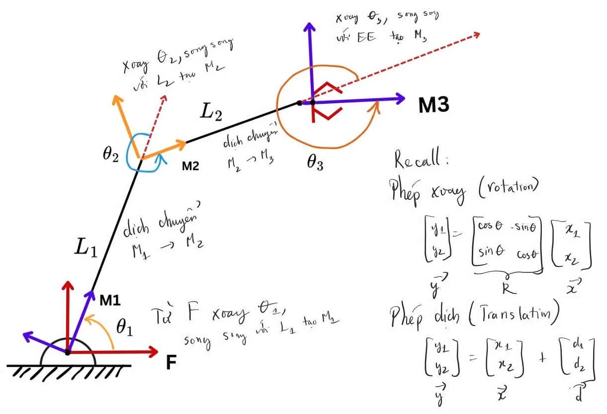
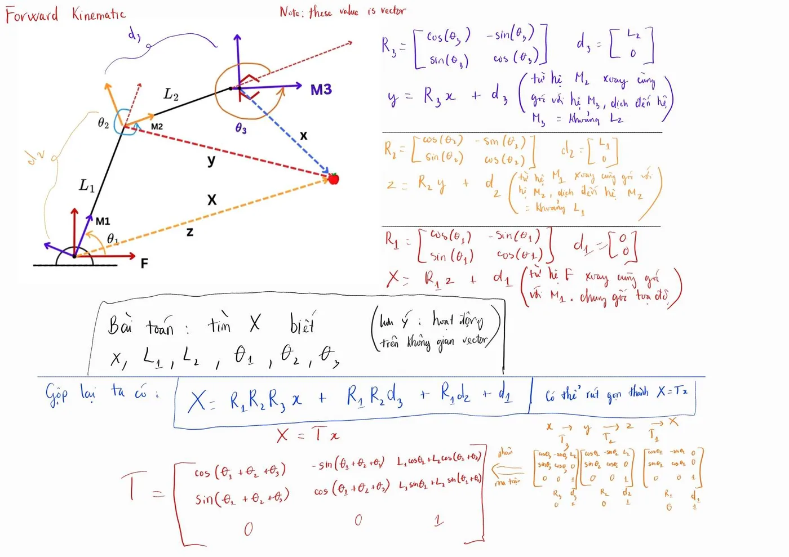
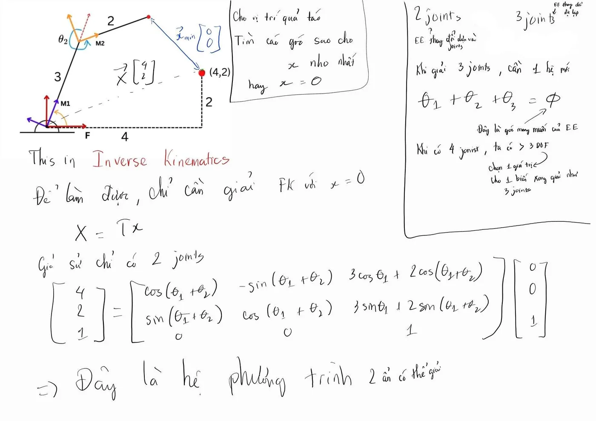

  <button type="button" class="btn btn--primary" data-lang="en">English</button>
  <button type="button" class="btn btn--inverse" data-lang="vi">Tiếng Việt</button>

**Learning from:** [Solved Example - Forward Kinematics](https://www.youtube.com/watch?v=_8T7RjXL07M) and [Build Robot using Simple High School Math](https://www.youtube.com/watch?v=8D0sO8mymQ8) (YouTube)
{: .notice--info}

These are my notes on the videos above, written the way I understand it. If you find a mistake, please email or message me.

This post follows my previous notes, [Robot Arm Basics: Rotation and Translation](/posts/2026/11/robot-arm-rotation-translation/). Here I use those two operations on a real example: **forward kinematics (FK)**, and then turn it around to get **inverse kinematics (IK)**.

**Forward kinematics** answers one question: *given the joint angles and link lengths, where is something (the end effector, or an object it sees) as seen from the base?*

## 1. Placing a frame on every joint

<figure>
  
  <figcaption>Fig 1. Building the frames from the base to the end effector.</figcaption>
</figure>

The arm has two links $$L_1$$, $$L_2$$ and three joint angles $$\theta_1, \theta_2, \theta_3$$. We walk from the base to the tip and place one frame at each step:

1. **F → M1**: start from the fixed frame F and rotate by $$\theta_1$$, so that the x-axis of M1 points along $$L_1$$. No translation yet ($$\vec{d}_1 = \vec{0}$$).
2. **M1 → M2**: move along $$L_1$$ to the second joint, then rotate by $$\theta_2$$ so the x-axis points along $$L_2$$.
3. **M2 → M3**: move along $$L_2$$ to the third joint, then rotate by $$\theta_3$$ so the frame lines up with the end effector.

Because each new x-axis points along the next link, every translation is simply "move $$L$$ along my own x-axis":

$$\vec{d}_1 = \begin{bmatrix}0\\0\end{bmatrix}, \quad \vec{d}_2 = \begin{bmatrix}L_1\\0\end{bmatrix}, \quad \vec{d}_3 = \begin{bmatrix}L_2\\0\end{bmatrix}, \qquad R_i = \begin{bmatrix}\cos\theta_i & -\sin\theta_i \\ \sin\theta_i & \cos\theta_i\end{bmatrix}$$

Note that $$\vec{d}_2$$ is written in M1 and $$\vec{d}_3$$ is written in M2, not in F.

## 2. The problem: where is the apple?

<figure>
  
  <figcaption>Fig 2. The same apple seen from four frames.</figcaption>
</figure>

**Given:** $$\vec{x}$$ (the apple's position seen from the end effector frame M3), $$L_1, L_2$$ and $$\theta_1, \theta_2, \theta_3$$.
**Find:** $$\vec{X}$$, the apple's position seen from the base frame F.

All of these are **position vectors**, not just distances: they have both a length and a direction.

We go back from the tip to the base, one frame at a time. Each step is "rotate, then translate" from the previous post:

| Step | Apple seen from | Formula |
|---|---|---|
| 1 | M2 | $$\vec{y} = R_3\vec{x} + \vec{d}_3$$ |
| 2 | M1 | $$\vec{z} = R_2\vec{y} + \vec{d}_2$$ |
| 3 | F  | $$\vec{X} = R_1\vec{z} + \vec{d}_1$$ |

Substituting step 1 into step 2, then into step 3:

$$\vec{X} = \underbrace{R_1R_2R_3\,\vec{x}}_{\text{rotation}} + \underbrace{R_1R_2\vec{d}_3 + R_1\vec{d}_2 + \vec{d}_1}_{\text{translation}}$$

## 3. One matrix for each step

With homogeneous coordinates (add a 1 at the end of each vector), each step becomes one 3×3 matrix:

$$T_i = \begin{bmatrix}R_i & \vec{d}_i \\ 0\;\;0 & 1\end{bmatrix}
\quad\Rightarrow\quad
T_1 = \begin{bmatrix}c_1 & -s_1 & 0\\ s_1 & c_1 & 0\\ 0 & 0 & 1\end{bmatrix},\;
T_2 = \begin{bmatrix}c_2 & -s_2 & L_1\\ s_2 & c_2 & 0\\ 0 & 0 & 1\end{bmatrix},\;
T_3 = \begin{bmatrix}c_3 & -s_3 & L_2\\ s_3 & c_3 & 0\\ 0 & 0 & 1\end{bmatrix}$$

Short notation to keep things readable: $$c_1 = \cos\theta_1$$, $$s_{12} = \sin(\theta_1+\theta_2)$$, $$c_{123} = \cos(\theta_1+\theta_2+\theta_3)$$, and so on.

The chain $$\vec{x} \xrightarrow{T_3} \vec{y} \xrightarrow{T_2} \vec{z} \xrightarrow{T_1} \vec{X}$$ gives

$$\vec{X} = T_1\,(T_2\,(T_3\,\vec{x})) = \underbrace{T_1T_2T_3}_{T}\,\vec{x}$$

**Order matters.** $$T_3$$ is applied first, so it sits closest to $$\vec{x}$$ (on the right). The product is $$T_1T_2T_3$$, not $$T_3T_2T_1$$.

## 4. Computing T = T1 T2 T3

Writing the three matrices side by side, this is what we need to compute:

$$T = T_1T_2T_3 = \begin{bmatrix}c_1 & -s_1 & 0\\ s_1 & c_1 & 0\\ 0 & 0 & 1\end{bmatrix}\begin{bmatrix}c_2 & -s_2 & L_1\\ s_2 & c_2 & 0\\ 0 & 0 & 1\end{bmatrix}\begin{bmatrix}c_3 & -s_3 & L_2\\ s_3 & c_3 & 0\\ 0 & 0 & 1\end{bmatrix}$$

We multiply from the right: first $$T_2T_3$$, then $$T_1(T_2T_3)$$. We also need these angle-sum formulas (from the previous post):

$$\cos(a+b) = \cos a\cos b - \sin a\sin b, \qquad \sin(a+b) = \sin a\cos b + \cos a\sin b$$

**Step 1: $$T_2T_3$$** (row × column):

$$T_2T_3 = \begin{bmatrix}c_2c_3 - s_2s_3 & -c_2s_3 - s_2c_3 & c_2L_2 + L_1\\ s_2c_3 + c_2s_3 & -s_2s_3 + c_2c_3 & s_2L_2\\ 0 & 0 & 1\end{bmatrix}
= \begin{bmatrix}c_{23} & -s_{23} & L_1 + L_2c_2\\ s_{23} & c_{23} & L_2s_2\\ 0 & 0 & 1\end{bmatrix}$$

**Step 2: $$T_1(T_2T_3)$$**:

$$T = T_1(T_2T_3) = \begin{bmatrix}c_1 & -s_1 & 0\\ s_1 & c_1 & 0\\ 0 & 0 & 1\end{bmatrix}\begin{bmatrix}c_{23} & -s_{23} & L_1 + L_2c_2\\ s_{23} & c_{23} & L_2s_2\\ 0 & 0 & 1\end{bmatrix}$$

$$= \begin{bmatrix}c_1c_{23} - s_1s_{23} & -c_1s_{23} - s_1c_{23} & c_1(L_1 + L_2c_2) - s_1L_2s_2\\ s_1c_{23} + c_1s_{23} & -s_1s_{23} + c_1c_{23} & s_1(L_1 + L_2c_2) + c_1L_2s_2\\ 0 & 0 & 1\end{bmatrix}$$

Simplify each entry with the angle-sum formulas:

- Top-left 2×2 block: $$c_1c_{23} - s_1s_{23} = c_{123}$$ and $$s_1c_{23} + c_1s_{23} = s_{123}$$.
- Last column, top: $$L_1c_1 + L_2(c_1c_2 - s_1s_2) = L_1c_1 + L_2c_{12}$$.
- Last column, middle: $$L_1s_1 + L_2(s_1c_2 + c_1s_2) = L_1s_1 + L_2s_{12}$$.

So the final result is

$$\boxed{T = \begin{bmatrix}\cos(\theta_1+\theta_2+\theta_3) & -\sin(\theta_1+\theta_2+\theta_3) & L_1\cos\theta_1 + L_2\cos(\theta_1+\theta_2)\\ \sin(\theta_1+\theta_2+\theta_3) & \cos(\theta_1+\theta_2+\theta_3) & L_1\sin\theta_1 + L_2\sin(\theta_1+\theta_2)\\ 0 & 0 & 1\end{bmatrix}}$$

This matches the expanded formula in Section 2:

- **Rotation part**: $$R_1R_2R_3 = R(\theta_1+\theta_2+\theta_3)$$. In 2D the angles just add up.
- **Translation part**: $$R_1\vec{d}_2 = L_1(\cos\theta_1, \sin\theta_1)$$ and $$R_1R_2\vec{d}_3 = L_2(\cos(\theta_1+\theta_2), \sin(\theta_1+\theta_2))$$. Each link is rotated by the sum of all angles *before* it. $$\theta_3$$ does not appear because it only turns the end effector; it does not move it.

## 5. Inverse kinematics: the reverse problem

<figure>
  
  <figcaption>Fig 3. Find the joint angles so the end effector reaches the apple.</figcaption>
</figure>

FK goes from angles to positions. **Inverse kinematics (IK)** goes the other way: we know where the end effector should go, and we look for the **joint angles**.

Usually we want the end effector to *touch* the apple, so the apple seen from the end effector is $$\vec{x} = (0, 0)$$. With $$\vec{x} = (0, 0, 1)$$, the product $$T\vec{x}$$ keeps only the last column of $$T$$. So IK is just the FK formula solved backwards with $$\vec{x} = 0$$.

**Example: 2 joints.** $$L_1 = 3$$, $$L_2 = 2$$, and the apple is at $$\vec{X} = (4, 2)$$:

$$\begin{bmatrix}4\\2\\1\end{bmatrix} = \begin{bmatrix}c_{12} & -s_{12} & 3c_1 + 2c_{12}\\ s_{12} & c_{12} & 3s_1 + 2s_{12}\\ 0 & 0 & 1\end{bmatrix}\begin{bmatrix}0\\0\\1\end{bmatrix}
\quad\Rightarrow\quad
\begin{cases}3\cos\theta_1 + 2\cos(\theta_1+\theta_2) = 4\\ 3\sin\theta_1 + 2\sin(\theta_1+\theta_2) = 2\end{cases}$$

Two equations, two unknowns, so we can solve it:

1. **Find $$\theta_2$$.** Square both equations and add them. With $$\cos^2 + \sin^2 = 1$$ and the $$\cos(a-b)$$ formula, everything except $$\theta_2$$ cancels:
   $$4^2 + 2^2 = 3^2 + 2^2 + 2\cdot3\cdot2\cos\theta_2 \;\Rightarrow\; \cos\theta_2 = \tfrac{7}{12} \;\Rightarrow\; \theta_2 \approx \pm 54.3^\circ$$
2. **Find $$\theta_1$$.** It is the angle to the apple minus the angle that link 2 adds:
   $$\theta_1 = \operatorname{atan2}(2, 4) - \operatorname{atan2}(2\sin\theta_2,\ 3 + 2\cos\theta_2)$$
   This gives $$\theta_1 \approx 47.9^\circ$$ with $$\theta_2 \approx -54.3^\circ$$ ("elbow up", as in Fig 3), or $$\theta_1 \approx 5.3^\circ$$ with $$\theta_2 \approx +54.3^\circ$$ ("elbow down").

Things to keep in mind:

- There are usually **two** solutions (elbow up and elbow down).
- There is **no** solution if the apple is out of reach: farther than $$L_1 + L_2$$ or closer than $$\lvert L_1 - L_2\rvert$$. Here $$\lVert\vec{X}\rVert = \sqrt{20} \approx 4.47 \le 5$$, so it is reachable. If it is not, the best we can do is make $$\lVert\vec{x}\rVert$$ as small as possible.
- With 2 joints we can only choose the position. The end effector's angle, $$\theta_1 + \theta_2$$, is whatever comes out.

**3 joints.** In 2D, a target has 3 numbers: position $$(x, y)$$ and the end effector's angle $$\phi$$. With a third joint we can choose $$\phi$$ too, which adds a third equation:

$$\theta_1 + \theta_2 + \theta_3 = \phi$$

Why the sum? Each $$\theta_i$$ is measured from the previous frame, not from F. So each joint turns everything after it on top of the turns before it. We already saw this in Section 4: the rotation part of $$T$$ is $$R_1R_2R_3 = R(\theta_1+\theta_2+\theta_3)$$, and that rotation is exactly the orientation of the end effector frame M3 seen from F. For the end effector to point at angle $$\phi$$, that total must equal $$\phi$$.

In our arm, $$\theta_3$$ only turns the end effector, so: solve $$\theta_1, \theta_2$$ as above, then $$\theta_3 = \phi - \theta_1 - \theta_2$$.

**4 or more joints.** Now the arm has more joints than the 3 numbers we need to control (it is *redundant*), so there are infinitely many solutions. A simple way out: fix the extra joint to any value you like, then solve as in the 3-joint case. In 3D, a target needs 6 numbers (3 for position, 3 for orientation). That is why arms like Piper have 6 joints, and Franka has 7 (one extra).

## Summary

- Forward kinematics: from joint angles and link lengths, find positions in the base frame.
- Put a frame at each joint with its x-axis along the next link, so each $$\vec{d}_i = (L, 0)$$ in its own frame.
- Go from the tip back to the base: $$\vec{X} = R_1R_2R_3\vec{x} + R_1R_2\vec{d}_3 + R_1\vec{d}_2 + \vec{d}_1$$.
- In matrix form, $$\vec{X} = T_1T_2T_3\,\vec{x}$$. The first transform applied ($$T_3$$) is on the right.
- For a planar arm, the rotation is $$R(\theta_1+\theta_2+\theta_3)$$ and the position of the end effector is $$(L_1\cos\theta_1 + L_2\cos(\theta_1+\theta_2),\ L_1\sin\theta_1 + L_2\sin(\theta_1+\theta_2))$$.
- Inverse kinematics: from a target position, find the joint angles. Set $$\vec{x} = 0$$ and solve the FK equations backwards.
- 2 joints control the position only. A 3rd joint also controls the end effector's angle $$\phi$$. Extra joints give infinitely many solutions, so fix the extras first.

**Học từ:** [Solved Example - Forward Kinematics](https://www.youtube.com/watch?v=_8T7RjXL07M) và [Build Robot using Simple High School Math](https://www.youtube.com/watch?v=8D0sO8mymQ8) (YouTube)
{: .notice--info}

Đây là ghi chú của mình khi học các video trên, viết theo cách mình hiểu. Nếu mình hiểu sai chỗ nào, hãy giúp mình chỉ ra bằng email hoặc nhắn tin cho mình nhé.

Bài này tiếp nối ghi chú trước của mình, [Robot Arm Basics: Rotation and Translation](/posts/2026/11/robot-arm-rotation-translation/). Ở đây mình áp dụng phép xoay và phép dịch chuyển vào một ví dụ cụ thể: **Forward Kinematics (FK)**, sau đó làm ngược lại để có **Inverse Kinematics (IK)**.

**Forward Kinematics** trả lời một câu hỏi: *biết góc của các khớp và chiều dài các link, một vật (end effector, hoặc vật mà nó nhìn thấy) nằm ở đâu khi nhìn từ base?*

## 1. Đặt hệ tọa độ tại mỗi khớp

<figure>
  
  <figcaption>Hình 1. Xây dựng các hệ tọa độ từ base đến end effector.</figcaption>
</figure>

Cánh tay có hai link $$L_1$$, $$L_2$$ và ba góc khớp $$\theta_1, \theta_2, \theta_3$$. Ta đi từ base đến đầu cánh tay và đặt một hệ tọa độ ở mỗi bước:

1. **F → M1**: từ hệ cố định F, xoay một góc $$\theta_1$$ sao cho trục x của M1 song song với $$L_1$$. Chưa dịch chuyển ($$\vec{d}_1 = \vec{0}$$).
2. **M1 → M2**: dịch dọc theo $$L_1$$ đến khớp thứ hai, rồi xoay $$\theta_2$$ để trục x song song với $$L_2$$.
3. **M2 → M3**: dịch dọc theo $$L_2$$ đến khớp thứ ba, rồi xoay $$\theta_3$$ để hệ song song với end effector.

Vì trục x của mỗi hệ mới luôn hướng theo link tiếp theo, nên mỗi phép dịch chỉ đơn giản là "đi một đoạn $$L$$ theo trục x của chính mình":

$$\vec{d}_1 = \begin{bmatrix}0\\0\end{bmatrix}, \quad \vec{d}_2 = \begin{bmatrix}L_1\\0\end{bmatrix}, \quad \vec{d}_3 = \begin{bmatrix}L_2\\0\end{bmatrix}, \qquad R_i = \begin{bmatrix}\cos\theta_i & -\sin\theta_i \\ \sin\theta_i & \cos\theta_i\end{bmatrix}$$

Lưu ý: $$\vec{d}_2$$ được viết trong hệ M1, và $$\vec{d}_3$$ được viết trong hệ M2, chứ không phải trong F.

## 2. Bài toán: quả táo nằm ở đâu?

<figure>
  
  <figcaption>Hình 2. Cùng một quả táo nhìn từ bốn hệ tọa độ.</figcaption>
</figure>

**Biết:** $$\vec{x}$$ (vị trí quả táo nhìn từ hệ end effector M3), $$L_1, L_2$$ và $$\theta_1, \theta_2, \theta_3$$.
**Tìm:** $$\vec{X}$$, vị trí quả táo nhìn từ hệ base F.

Tất cả đều là **vector vị trí**, không chỉ là khoảng cách: chúng có cả độ dài và hướng.

Ta đi ngược từ đầu cánh tay về base, từng hệ một. Mỗi bước là "xoay rồi dịch" như bài trước:

| Bước | Quả táo nhìn từ | Công thức |
|---|---|---|
| 1 | M2 | $$\vec{y} = R_3\vec{x} + \vec{d}_3$$ |
| 2 | M1 | $$\vec{z} = R_2\vec{y} + \vec{d}_2$$ |
| 3 | F  | $$\vec{X} = R_1\vec{z} + \vec{d}_1$$ |

Thay bước 1 vào bước 2, rồi vào bước 3:

$$\vec{X} = \underbrace{R_1R_2R_3\,\vec{x}}_{\text{xoay}} + \underbrace{R_1R_2\vec{d}_3 + R_1\vec{d}_2 + \vec{d}_1}_{\text{dịch chuyển}}$$

## 3. Mỗi bước là một ma trận

Dùng tọa độ thuần nhất (thêm số 1 vào cuối mỗi vector), mỗi bước trở thành một ma trận 3×3:

$$T_i = \begin{bmatrix}R_i & \vec{d}_i \\ 0\;\;0 & 1\end{bmatrix}
\quad\Rightarrow\quad
T_1 = \begin{bmatrix}c_1 & -s_1 & 0\\ s_1 & c_1 & 0\\ 0 & 0 & 1\end{bmatrix},\;
T_2 = \begin{bmatrix}c_2 & -s_2 & L_1\\ s_2 & c_2 & 0\\ 0 & 0 & 1\end{bmatrix},\;
T_3 = \begin{bmatrix}c_3 & -s_3 & L_2\\ s_3 & c_3 & 0\\ 0 & 0 & 1\end{bmatrix}$$

Ký hiệu viết tắt cho gọn: $$c_1 = \cos\theta_1$$, $$s_{12} = \sin(\theta_1+\theta_2)$$, $$c_{123} = \cos(\theta_1+\theta_2+\theta_3)$$, v.v.

Chuỗi $$\vec{x} \xrightarrow{T_3} \vec{y} \xrightarrow{T_2} \vec{z} \xrightarrow{T_1} \vec{X}$$ cho ta

$$\vec{X} = T_1\,(T_2\,(T_3\,\vec{x})) = \underbrace{T_1T_2T_3}_{T}\,\vec{x}$$

**Thứ tự rất quan trọng.** $$T_3$$ được áp dụng đầu tiên nên nó đứng sát $$\vec{x}$$ (bên phải). Tích là $$T_1T_2T_3$$, không phải $$T_3T_2T_1$$.

## 4. Tính T = T1 T2 T3

Viết ba ma trận cạnh nhau, đây là phép tính ta cần làm:

$$T = T_1T_2T_3 = \begin{bmatrix}c_1 & -s_1 & 0\\ s_1 & c_1 & 0\\ 0 & 0 & 1\end{bmatrix}\begin{bmatrix}c_2 & -s_2 & L_1\\ s_2 & c_2 & 0\\ 0 & 0 & 1\end{bmatrix}\begin{bmatrix}c_3 & -s_3 & L_2\\ s_3 & c_3 & 0\\ 0 & 0 & 1\end{bmatrix}$$

Ta nhân từ phải sang: trước tiên tính $$T_2T_3$$, sau đó tính $$T_1(T_2T_3)$$. Nhắc lại công thức cộng góc (từ bài trước):

$$\cos(a+b) = \cos a\cos b - \sin a\sin b, \qquad \sin(a+b) = \sin a\cos b + \cos a\sin b$$

**Bước 1: $$T_2T_3$$** (hàng × cột):

$$T_2T_3 = \begin{bmatrix}c_2c_3 - s_2s_3 & -c_2s_3 - s_2c_3 & c_2L_2 + L_1\\ s_2c_3 + c_2s_3 & -s_2s_3 + c_2c_3 & s_2L_2\\ 0 & 0 & 1\end{bmatrix}
= \begin{bmatrix}c_{23} & -s_{23} & L_1 + L_2c_2\\ s_{23} & c_{23} & L_2s_2\\ 0 & 0 & 1\end{bmatrix}$$

**Bước 2: $$T_1(T_2T_3)$$**:

$$T = T_1(T_2T_3) = \begin{bmatrix}c_1 & -s_1 & 0\\ s_1 & c_1 & 0\\ 0 & 0 & 1\end{bmatrix}\begin{bmatrix}c_{23} & -s_{23} & L_1 + L_2c_2\\ s_{23} & c_{23} & L_2s_2\\ 0 & 0 & 1\end{bmatrix}$$

$$= \begin{bmatrix}c_1c_{23} - s_1s_{23} & -c_1s_{23} - s_1c_{23} & c_1(L_1 + L_2c_2) - s_1L_2s_2\\ s_1c_{23} + c_1s_{23} & -s_1s_{23} + c_1c_{23} & s_1(L_1 + L_2c_2) + c_1L_2s_2\\ 0 & 0 & 1\end{bmatrix}$$

Rút gọn từng phần tử bằng công thức cộng góc:

- Khối 2×2 trên bên trái: $$c_1c_{23} - s_1s_{23} = c_{123}$$ và $$s_1c_{23} + c_1s_{23} = s_{123}$$.
- Cột cuối, hàng đầu: $$L_1c_1 + L_2(c_1c_2 - s_1s_2) = L_1c_1 + L_2c_{12}$$.
- Cột cuối, hàng giữa: $$L_1s_1 + L_2(s_1c_2 + c_1s_2) = L_1s_1 + L_2s_{12}$$.

Vậy kết quả cuối cùng là

$$\boxed{T = \begin{bmatrix}\cos(\theta_1+\theta_2+\theta_3) & -\sin(\theta_1+\theta_2+\theta_3) & L_1\cos\theta_1 + L_2\cos(\theta_1+\theta_2)\\ \sin(\theta_1+\theta_2+\theta_3) & \cos(\theta_1+\theta_2+\theta_3) & L_1\sin\theta_1 + L_2\sin(\theta_1+\theta_2)\\ 0 & 0 & 1\end{bmatrix}}$$

Kết quả này khớp với công thức khai triển ở Mục 2:

- **Phần xoay**: $$R_1R_2R_3 = R(\theta_1+\theta_2+\theta_3)$$. Trong 2D, các góc chỉ việc cộng lại.
- **Phần dịch chuyển**: $$R_1\vec{d}_2 = L_1(\cos\theta_1, \sin\theta_1)$$ và $$R_1R_2\vec{d}_3 = L_2(\cos(\theta_1+\theta_2), \sin(\theta_1+\theta_2))$$. Mỗi link bị xoay bởi tổng các góc *đứng trước* nó. $$\theta_3$$ không xuất hiện vì nó chỉ xoay end effector chứ không làm end effector di chuyển.

## 5. Inverse Kinematics: bài toán ngược

<figure>
  
  <figcaption>Hình 3. Tìm góc các khớp để end effector chạm tới quả táo.</figcaption>
</figure>

FK đi từ góc khớp ra vị trí. **Inverse Kinematics (IK)** làm ngược lại: ta biết end effector cần đến đâu, và cần tìm **góc của các khớp**.

Thường thì ta muốn end effector *chạm* vào quả táo, tức quả táo nhìn từ end effector là $$\vec{x} = (0, 0)$$. Với $$\vec{x} = (0, 0, 1)$$, phép nhân $$T\vec{x}$$ chỉ giữ lại cột cuối của $$T$$. Vậy IK chính là công thức FK giải ngược với $$\vec{x} = 0$$.

**Ví dụ: 2 khớp.** $$L_1 = 3$$, $$L_2 = 2$$, quả táo ở $$\vec{X} = (4, 2)$$:

$$\begin{bmatrix}4\\2\\1\end{bmatrix} = \begin{bmatrix}c_{12} & -s_{12} & 3c_1 + 2c_{12}\\ s_{12} & c_{12} & 3s_1 + 2s_{12}\\ 0 & 0 & 1\end{bmatrix}\begin{bmatrix}0\\0\\1\end{bmatrix}
\quad\Rightarrow\quad
\begin{cases}3\cos\theta_1 + 2\cos(\theta_1+\theta_2) = 4\\ 3\sin\theta_1 + 2\sin(\theta_1+\theta_2) = 2\end{cases}$$

Hệ 2 phương trình, 2 ẩn, nên giải được:

1. **Tìm $$\theta_2$$.** Bình phương hai phương trình rồi cộng lại. Dùng $$\cos^2 + \sin^2 = 1$$ và công thức $$\cos(a-b)$$, mọi thứ trừ $$\theta_2$$ đều triệt tiêu:
   $$4^2 + 2^2 = 3^2 + 2^2 + 2\cdot3\cdot2\cos\theta_2 \;\Rightarrow\; \cos\theta_2 = \tfrac{7}{12} \;\Rightarrow\; \theta_2 \approx \pm 54.3^\circ$$
2. **Tìm $$\theta_1$$.** Bằng góc hướng tới quả táo trừ đi góc mà link 2 tạo thêm:
   $$\theta_1 = \operatorname{atan2}(2, 4) - \operatorname{atan2}(2\sin\theta_2,\ 3 + 2\cos\theta_2)$$
   Ta được $$\theta_1 \approx 47.9^\circ$$ với $$\theta_2 \approx -54.3^\circ$$ ("khuỷu tay hướng lên", như Hình 3), hoặc $$\theta_1 \approx 5.3^\circ$$ với $$\theta_2 \approx +54.3^\circ$$ ("khuỷu tay hướng xuống").

Một vài lưu ý:

- Thường có **hai** nghiệm (khuỷu lên và khuỷu xuống).
- **Không** có nghiệm nếu quả táo ngoài tầm với: xa hơn $$L_1 + L_2$$ hoặc gần hơn $$\lvert L_1 - L_2\rvert$$. Ở đây $$\lVert\vec{X}\rVert = \sqrt{20} \approx 4.47 \le 5$$ nên với tới được. Nếu không với tới được, cách tốt nhất là làm cho $$\lVert\vec{x}\rVert$$ nhỏ nhất có thể.
- Với 2 khớp, ta chỉ chọn được vị trí. Góc của end effector, $$\theta_1 + \theta_2$$, ra bao nhiêu thì nhận bấy nhiêu.

**3 khớp.** Trong 2D, mục tiêu gồm 3 số: vị trí $$(x, y)$$ và góc của end effector $$\phi$$. Có thêm khớp thứ ba thì ta chọn được cả $$\phi$$, tức thêm phương trình thứ ba:

$$\theta_1 + \theta_2 + \theta_3 = \phi$$

Tại sao lại là tổng? Mỗi $$\theta_i$$ được đo so với hệ trước đó, chứ không phải so với F. Vì vậy mỗi khớp xoay mọi thứ phía sau nó, chồng thêm lên các góc đã xoay trước đó. Ta đã thấy điều này ở Mục 4: phần xoay của $$T$$ là $$R_1R_2R_3 = R(\theta_1+\theta_2+\theta_3)$$, và phép xoay này chính là hướng của hệ end effector M3 khi nhìn từ F. Muốn end effector hướng theo góc $$\phi$$ thì tổng này phải bằng $$\phi$$.

Trong cánh tay của ta, $$\theta_3$$ chỉ xoay end effector, nên: giải $$\theta_1, \theta_2$$ như trên, rồi $$\theta_3 = \phi - \theta_1 - \theta_2$$.

**4 khớp trở lên.** Lúc này số khớp nhiều hơn 3 số cần điều khiển (cánh tay bị *dư*, redundant), nên có vô số nghiệm. Cách đơn giản: chọn một giá trị bất kỳ cho khớp dư, rồi giải như trường hợp 3 khớp. Trong 3D, mục tiêu cần 6 số (3 cho vị trí, 3 cho hướng). Vì vậy các cánh tay như Piper có 6 khớp, còn Franka có 7 (dư một khớp).

## Tóm tắt

- Forward Kinematics: từ góc khớp và chiều dài link, tìm vị trí trong hệ base.
- Đặt một hệ tọa độ tại mỗi khớp với trục x hướng theo link tiếp theo, nên mỗi $$\vec{d}_i = (L, 0)$$ trong hệ của chính nó.
- Đi ngược từ đầu cánh tay về base: $$\vec{X} = R_1R_2R_3\vec{x} + R_1R_2\vec{d}_3 + R_1\vec{d}_2 + \vec{d}_1$$.
- Dạng ma trận: $$\vec{X} = T_1T_2T_3\,\vec{x}$$. Phép biến đổi được áp dụng đầu tiên ($$T_3$$) đứng bên phải.
- Với cánh tay phẳng, phần xoay là $$R(\theta_1+\theta_2+\theta_3)$$ và vị trí end effector là $$(L_1\cos\theta_1 + L_2\cos(\theta_1+\theta_2),\ L_1\sin\theta_1 + L_2\sin(\theta_1+\theta_2))$$.
- Inverse Kinematics: từ vị trí mục tiêu, tìm góc các khớp. Cho $$\vec{x} = 0$$ và giải ngược các phương trình FK.
- 2 khớp chỉ điều khiển được vị trí. Khớp thứ 3 điều khiển thêm góc $$\phi$$ của end effector. Khớp dư cho vô số nghiệm, nên cố định các khớp dư trước.

